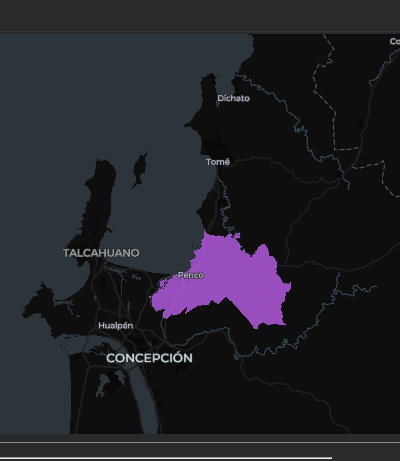

# FieldMaps | Exploración y descarga interactiva de límites administrativos

Datos geoespaciales con **Python, SQL y DuckDB**.

📓 Notebook: [`FieldMaps_geoboundaries_reutilizable.ipynb`](FieldMaps_geoboundaries_reutilizable.ipynb) · [Abrir en Colab](https://colab.research.google.com/github/Zelaznog-J/fieldmaps_boundaries/blob/main/FieldMaps_geoboundaries_reutilizable.ipynb)

> **Nota:** el notebook se publica **sin salidas guardadas**, para no asociar cifras o mapas de una ejecución anterior a selecciones nuevas. Los resultados que se citan abajo y la imagen provienen de una ejecución de ejemplo en Colab (2 de noviembre de 2026) y pueden variar si FieldMaps actualiza la fuente. Para verlos, ejecuta el notebook y responde los `input()`.

*Captura de la ejecución de ejemplo: `CHL` → Región del Biobío → Penco (no se guarda dentro del notebook).*

## Overview

Notebook reutilizable que consulta directamente el archivo Parquet público de [FieldMaps (`adm4_polygons`)](https://data.fieldmaps.io/edge-matched/open/intl/adm4_polygons.parquet) (~180 mil registros, 318 valores de `adm0_src`) y permite elegir, de forma interactiva, un país, una región y opcionalmente una comuna/unidad ADM3. El resultado es un GeoJSON listo para usar y un mapa interactivo, **sin descargar el archivo completo ni editar las consultas SQL**.

**Stack:** DuckDB (+ extensión `spatial`), SQL parametrizado, Pandas, GeoPandas, Lonboard. Funciona en Google Colab y en Jupyter local.

## Objetivos

- Construir un procedimiento **reutilizable**: ningún país ni región queda fijado en el código.
- Explorar una fuente remota y listar los valores administrativos realmente disponibles antes de filtrar.
- Evitar errores de escritura (tildes, apóstrofes, codificación) permitiendo elegir **por número o por texto**.
- Mantener consultas seguras mediante **parámetros SQL (`?`)** en vez de concatenar texto.
- Producir entregables concretos: subconjunto geoespacial validado, resumen por ADM2, GeoJSON y visualización.

## Workflow

1. **Entorno:** detecta Colab/local e instala solo las dependencias faltantes.
2. **Conexión:** DuckDB lee el Parquet por HTTP; la extensión `spatial` entrega la geometría como WKB (`ST_AsWKB`).
3. **Exploración:** cuenta registros (179.893) y revisa el esquema de columnas.
4. **Selección en cascada con `input()`:**
   - `adm0_src` → lista completa de 318 valores (ej. `CHL`).
   - `adm1_name` → regiones del ADM0 elegido (16 en Chile).
   - `adm2_name` + `adm3_name` (opcional) → 33 unidades en Biobío; *Enter* conserva todo ADM1.
5. **Extracción:** consulta parametrizada que trae solo los campos necesarios.
6. **GeoDataFrame y control de calidad:** asigna EPSG:4326, cuenta geometrías nulas e inválidas.
7. **Resumen** de registros por ADM2.
8. **Exportación** a GeoJSON (carpeta local o Google Drive) con nombre de archivo generado automáticamente.
9. **Visualización** interactiva con Lonboard.

## Key Findings

*Observados en la ejecución de ejemplo (2 de noviembre de 2026); las cifras dependen de la versión de la fuente.*

- **Un solo flujo, cualquier territorio:** el mismo notebook sirvió para recorrer los 318 `adm0_src` y llegar, por ejemplo, desde `CHL` → Región del Biobío → comuna de Penco (1 registro, 0 geometrías nulas o inválidas).
- **Consultar sin descargar:** DuckDB filtra el Parquet remoto y solo transfiere lo necesario, lo que hace viable trabajar con ~180 mil polígonos desde Colab.
- **Problema de codificación en la fuente:** varios nombres llegan con caracteres alterados (p. ej. `Región del Bío-Bío`). Seleccionar por índice lo sortea, y `nombre_archivo_seguro` normaliza los nombres de salida, aunque no corrige el dato de origen.
- **Granularidad ≠ unidad administrativa:** el recurso contiene polígonos ADM4, por lo que filtrar por ADM3 puede devolver varias filas; para un único límite habría que hacer un `dissolve`.
- **El CRS se asume, no se verifica:** se declara EPSG:4326; antes de medir áreas o distancias hay que confirmarlo y reproyectar.
- **Posibles mejoras:** fijar versiones de librerías, disolver geometrías por unidad, parametrizar sin `input()` para ejecución por lotes y corregir la codificación en origen.

## Fuente de datos

[FieldMaps — ADM4 polygons](https://data.fieldmaps.io/edge-matched/open/intl/adm4_polygons.parquet). Revisar licencia y versión antes de usar los datos en decisiones técnicas.
